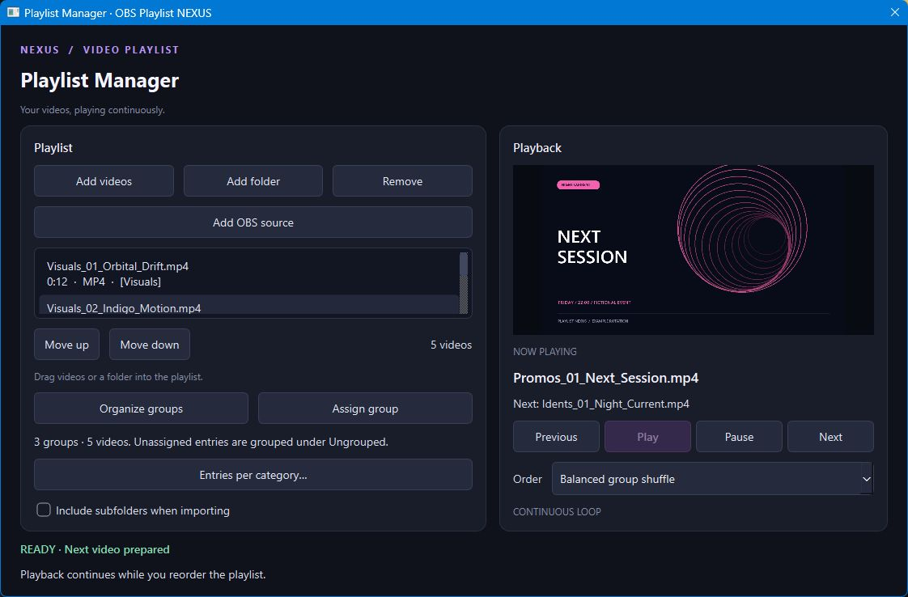
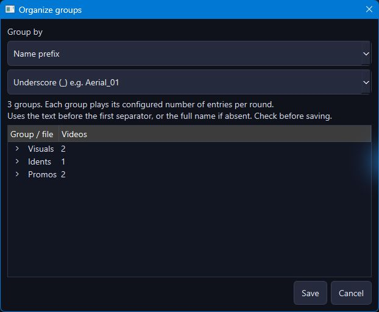
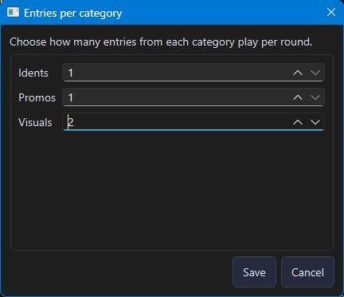
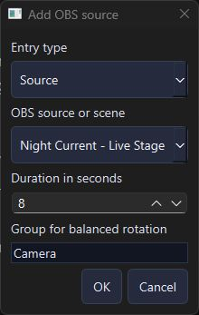

# OBS Playlist NEXUS

**Your videos, playing continuously.**

A native video playlist source for OBS Studio on Windows x64. Build a continuous rotation of local videos, organize content into categories, and bring existing OBS sources or scenes into the same playlist.

**Version 1.0.0 · Windows x64 · OBS Studio 32 / 33 · Video only**

## Features

- **Continuous playback:** the next local video is prepared while the current one plays.
- **Three playback modes:** Sequential, Shuffle and Balanced group shuffle.
- **Category quotas:** choose how many entries each category contributes per round.
- **Flexible organization:** group by filename prefix, parent folder or manual assignment, or use one ungrouped pool.
- **Dedicated Playlist Manager:** preview the current video, see what is next, and edit the list while playback continues.
- **Easy importing:** add individual videos, import a folder, drag files or folders into the list, and optionally include subfolders.
- **OBS sources and scenes:** insert an existing video source, scene or scene group for a configurable duration.
- **Playback controls:** Play, Pause, Next, Previous and double-click navigation.
- **Visibility policies:** continue or restart when shown; pause or continue when hidden.
- **Source hotkeys:** assign Play, Pause, Next and Previous in OBS Settings → Hotkeys.
- **Five languages:** English, Spanish, French, German and Italian, following the OBS language.

## Quick start

1. Build the plugin using the [build guide](docs/BUILDING.md), then install it with its compatible runtime dependencies into your OBS installation.
2. Add an **OBS Playlist NEXUS** source to your scene.
3. Open its properties and click **Open Playlist Manager**.
4. Use **Add videos**, **Add folder** or drag and drop to create your playlist.
5. Choose an **Order** mode and press **Play**.

This repository provides source code and example screenshots. It does not bundle OBS, Qt, FFmpeg runtime binaries or a ready-to-install download.

## Playback modes

| Mode | Behavior | Typical use |
| --- | --- | --- |
| Sequential | Plays entries in playlist order and loops. | A planned show sequence. |
| Shuffle | Randomizes the playlist without category balancing. | A general visual rotation. |
| Balanced group shuffle | Uses category quotas and independent shuffled pools. | Mix visuals, station idents and announcements. |

### Example: Night Current

The screenshots use a fictional electronic-session rotation with five original example clips. **Visuals** contains two clips, **Idents** one, and **Promos** two. With quotas of 2 Visuals, 1 Ident and 1 Promo, a round requests that mix regardless of how many files each category contains. Quotas count entries, not seconds, so clip lengths still affect screen time.

The screenshots show the actual English Playlist Manager and its dialogs; they are not UI mockups. The names and artwork belong to the fictional example.

## Groups and categories

Click **Organize groups** to choose an organization rule and preview the result before saving.

| Grouping option | What it does |
| --- | --- |
| No groups | Uses one shared shuffle pool. |
| Name prefix | Uses text before the first underscore, hyphen or space. For example, `Visuals_01.mp4` belongs to Visuals. |
| Parent subfolder | Uses each file's immediate parent folder as its group. |
| Manual | Lets you select entries and use **Assign group**. |

Entries without an assigned group participate as **Ungrouped**. Enable **Include subfolders when importing** if your media library is nested.

### Entries per category

Click **Entries per category…** to set a value from **1 to 99** for each category. These values control Balanced group shuffle. Save the dialog to apply the mix.

## Add OBS sources and scenes

Use **Add OBS source** to select an existing video source or scene, or choose **Group** to select a scene group. Set its duration from **1 to 3600 seconds** and optionally assign a category. Live entries participate in all three playback modes alongside local files.

Keep the scene you want to rotate separate from the scene containing Playlist NEXUS. Sources that contain Playlist NEXUS are excluded to avoid recursive rendering. A live source that is not ready within two seconds is skipped. Live entries are shown in OBS output; the manager identifies them as live rather than displaying the local-video preview.

## Playlist Manager controls

| Control | Purpose |
| --- | --- |
| Add videos / Add folder | Import local MP4, MKV, MOV and WebM files, subject to codec support. |
| Remove | Removes selected playlist entries without deleting the media files. |
| Move up / Move down | Reorders selected content. |
| Play / Pause | Resumes or freezes playback. |
| Next / Previous | Advances to the next entry or returns through playback history. |
| Double-click an entry | Jumps to that entry. |
| Now playing / Next | Identifies current and upcoming content. |
| Ready / Preparing | Shows whether the next video is prepared. |

The playlist loops continuously. Reordering while retaining the current file does not restart its decoder. Unreadable files are skipped; playback suspends if no usable candidate remains.

## Source visibility options

In source properties, choose **Continue** or **Restart playlist** for **When source becomes visible**. Choose **Pause** or **Continue** for **When source becomes hidden**. These options let a rotation resume with a scene or keep progressing in the background.

## Requirements and limitations

- Windows x64 with OBS Studio 32 or 33 and compatible Qt 6.8+ / FFmpeg 7 runtime libraries.
- Video output only: Playlist NEXUS does not output clip or live-source audio. Manage audio separately in OBS.
- Fixed **1920 × 1080** source canvas with proportional centered fitting.
- Local file playback; network URLs are outside the supported scope.
- Software video decoding; hardware decoding is not implemented.
- HDR/color-managed playback, rotation metadata and sample-aspect-ratio handling are not implemented. Prepare standard SDR, square-pixel media for predictable results.
- Input dimensions exceeding 3840 × 2160 are rejected.
- Smooth transitions depend on media, storage speed and system load; no universal gapless guarantee is made.

## Build and license

See [Building from source](docs/BUILDING.md) and [Third-party dependencies](THIRD-PARTY-NOTICES.md).

Project source: **GPL-2.0-or-later**. See [LICENSE](LICENSE) and [COPYING-NOTICE.md](COPYING-NOTICE.md).

*a plugin from [DjEmiMas](https://discord.gg/dhcqZPDYh)*
